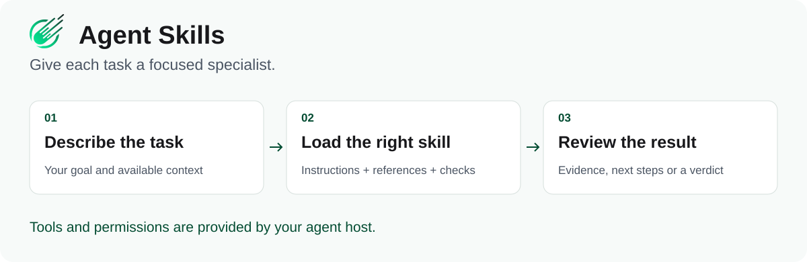

# CometWeb Agent Skills

Agent Skills with executable package and contract tests for research, product decisions, QA and release gates, installable in Cursor, Claude Code, Codex and other hosts that read `SKILL.md` packages.

**Experimental distribution:** task qualification is unestablished for the
published packages. Each installed folder and ZIP carries its declared stage and
experimental status; see [skill maturity](docs/SKILL-MATURITY.md) for the four stages and
the boundary between package checks and task evidence.



[](https://github.com/CometWeb-io/agent-skills/actions/workflows/validate.yml)
[](LICENSE)


This repository contains 34 reusable skill packages. Each one is a `SKILL.md`
entry point plus the references, scripts and eval cases it needs, and every
package is covered by the test suite. Skills supply instructions and output
contracts. They do not supply a model, connector accounts or permission to act:
browser access, connectors and external side effects stay with your host and
your authorization.

- [Quickstart](#quickstart)
- [Pick a starting point](#pick-a-starting-point)
- [Skill catalog](#skill-catalog)
- [How skills hand off: CW-AIP](#how-skills-hand-off-cw-aip)
- [Write and evaluate a new skill](#write-and-evaluate-a-new-skill)
- [Contributing](#contributing)

## What the tests establish

| Evidence | What passing establishes | What remains unmeasured |
| --- | --- | --- |
| Package gates and CI badges above | The identified source meets package, security and contract checks | Correctness of every model answer |
| Deterministic behavior suites | Helpers enforce their tested invariants | Live task success and comparative lift |
| Host adapters and compatibility matrix | Declared formats and capabilities; Claude/Codex execution adapters exist | A successful session on every host/model |
| Real-host evals | Only the recorded runs, exact identities and reviewed outcomes | General effectiveness without independent, repeated A/B |

Live task success remains **NOT_ASSESSED** for the catalog as a whole.
[Real-host evaluation](docs/REAL-HOST-EVALS.md) separates structural grades,
blind review, cost and missing execution. A passing CI run grants no release authority.

## Quickstart

Clone once, then run the installer for your host. Installers **symlink** each
package from `skills/` into the host's skills directory, so keep the clone where
it is; `git pull` updates every installed skill in place.

```bash
git clone https://github.com/CometWeb-io/agent-skills.git
cd agent-skills
./scripts/install-claude.sh --skill evidence-researcher --skill product-operator
# Other hosts: install-cursor.sh, install-codex.sh, install-qwen.sh,
# install-qoder.sh, install-lingma.sh. Omit --skill to install every package.
# ./scripts/install-all.sh explicitly installs into all six hosts.
```

Installing every package ends with a line such as `OK: 34 Claude Code skills installed in /home/you/.claude/skills`.
Installers support repeatable `--skill ID` and `--ref <full-commit-SHA>` for a
clean pinned checkout. Keep stable installations on a detached reviewed commit;
see [pinning and rollback](INSTALL.md#pinning-and-rollback).
Installers are safe to rerun, stop before changing anything when a target path
is already taken, and accept `--dry-run` and `--uninstall`.
[INSTALL.md](INSTALL.md) lists each host's target directory and override
variable, conflict backups, upgrades, and the plugin marketplaces for Claude
Code, ChatGPT and Codex.

Claude Code can install the same skills as a plugin instead, without a clone:

```bash
claude plugin marketplace add CometWeb-io/agent-skills
claude plugin install cometweb-agent-skills@cometweb-agent-skills
```

Then ask your assistant:

```text
Use product-operator to compare this repo with the roadmap.
Give me the three most useful next actions and how to verify each one.
```

## Pick a starting point

Use the [owner and handoff map](docs/SKILL-MAP.md) to choose a task owner,
follow its output contract, and install a small core plus the needed domain skills.

| You need to… | Start with | You get |
| --- | --- | --- |
| Check a claim | [evidence-researcher](skills/evidence-researcher/) | Sources, contradictions and an Evidence Pack |
| Decide what to do next | [product-operator](skills/product-operator/) | A bounded now / next / stop list |
| Inspect an app | [web-app-auditor](skills/web-app-auditor/) | Findings tied to observed behavior |
| Review a release | [release-readiness](skills/release-readiness/) | A verdict for a specific candidate |
| Combine specialists | [skill-orchestrator](skills/skill-orchestrator/) | Ordered steps and structured handoffs |

For isolated specialist runs, use [skill-orchestrator-multiagent](skills/skill-orchestrator-multiagent/).

## Skill catalog

<!-- BEGIN GENERATED: skill catalog (tooling/generate_adapters.py) -->
<!-- Edit registry/readme-catalog.json or registry/skills.json, then run generate_adapters.py. -->

**34 skills.** Versions come from each package's `VERSION`; the [compatibility matrix](docs/generated-compatibility-matrix.md) lists host support.

### Foundation and orchestration

| Skill | Use it for | Version |
| --- | --- | ---: |
| [`ai-council`](skills/ai-council/) | Evidence-governed decisions, risk gates, forecasts, and GO / TEST / DEFER verdicts. *(experimental; DEVELOPMENT; runs only when named)* | 5.3.1 |
| [`cometweb-context`](skills/cometweb-context/) | Fresh, provenance-aware context snapshots before work that depends on current project state. *(experimental; DEVELOPMENT)* | 1.6.1 |
| [`evidence-researcher`](skills/evidence-researcher/) | Claim decomposition, source verification, falsifiers, contradictions, and Evidence Packs. *(experimental; DEVELOPMENT)* | 1.0.9 |
| [`portfolio-operator`](skills/portfolio-operator/) | Cross-project focus, capacity conflicts, and pause / delegate decisions. *(experimental; DEVELOPMENT)* | 1.2.5 |
| [`skill-orchestrator`](skills/skill-orchestrator/) | Multi-skill workflows with ordered steps and CW-AIP handoffs. *(experimental; DEVELOPMENT)* | 1.4.2 |
| [`skill-orchestrator-multiagent`](skills/skill-orchestrator-multiagent/) | Isolated subagent execution for multi-skill workflows. *(experimental; DEVELOPMENT)* | 1.2.3 |
| [`benchmark-curator`](skills/benchmark-curator/) | Benchmark corpora, holdouts, contamination controls, and revision hashes. *(experimental; DEVELOPMENT)* | 1.7.5 |
| [`feedback-integrator`](skills/feedback-integrator/) | Recurring failure patterns, improvement proposals, and regression tests. *(experimental; DEVELOPMENT)* | 1.8.2 |
| [`quality-loop-operator`](skills/quality-loop-operator/) | Briefing, review, repair, acceptance, measurement, and quality lifecycle control. *(experimental; DEVELOPMENT)* | 1.7.7 |
| [`rubric-designer`](skills/rubric-designer/) | Observable evaluation criteria, evidence floors, blocker rules, and rubric locks. *(experimental; DEVELOPMENT)* | 1.7.7 |
| [`skill-auditor`](skills/skill-auditor/) | Skill routing, portability, package hygiene, and supply-chain audits. *(experimental; DEVELOPMENT)* | 1.7.6 |
| [`skill-evaluator`](skills/skill-evaluator/) | Fair skill experiments, behavioral lift, resource cost, and host comparisons. *(experimental; DEVELOPMENT)* | 1.8.1 |

### Product, research, and partnerships

| Skill | Use it for | Version |
| --- | --- | ---: |
| [`ai-humanize`](skills/ai-humanize/) | Natural English and Polish rewrites that preserve meaning and voice. *(experimental; DEVELOPMENT)* | 2.6.5 |
| [`competitive-intelligence`](skills/competitive-intelligence/) | Competitor watchlists, change detection, and recurring delta digests. *(experimental; DEVELOPMENT)* | 1.1.5 |
| [`design-partner-finder`](skills/design-partner-finder/) | Finding, qualifying, and managing design partners and early adopters. *(experimental; DEVELOPMENT)* | 1.2.5 |
| [`product-operator`](skills/product-operator/) | Weekly product control loops, roadmap drift, and now / next / later / stop actions. *(experimental; DEVELOPMENT)* | 2.4.4 |
| [`product-teardown`](skills/product-teardown/) | Evidence-backed product, UX, architecture, and implementation pattern analysis. *(experimental; DEVELOPMENT)* | 1.3.2 |
| [`repo-to-roadmap`](skills/repo-to-roadmap/) | Whole-project baselines, gap inventories, dependencies, and target-state roadmaps. *(experimental; DEVELOPMENT)* | 1.1.3 |
| [`brief-architect`](skills/brief-architect/) | Explicit artifact contracts, evidence policies, risks, and acceptance criteria. *(experimental; DEVELOPMENT)* | 1.8.1 |
| [`content-writer`](skills/content-writer/) | Evidence-aware reader-facing articles, guides, reports, and documentation. *(experimental; DEVELOPMENT)* | 1.7.7 |
| [`content-reviewer`](skills/content-reviewer/) | Constructive editorial QA with evidence-backed, actionable findings. *(experimental; DEVELOPMENT)* | 1.7.6 |
| [`content-roaster`](skills/content-roaster/) | Adversarial content review, proof debt, objections, and repair verification. *(experimental; DEVELOPMENT)* | 6.1.7 |
| [`science-roaster`](skills/science-roaster/) | Reviewer #2-style critique of methods, inference, validity, and reproducibility. *(experimental; DEVELOPMENT)* | 6.1.7 |
| [`repo-roaster`](skills/repo-roaster/) | Adversarial repository review with invariants, reachability, and repair contracts. *(experimental; DEVELOPMENT)* | 6.1.7 |
| [`repair-operator`](skills/repair-operator/) | Minimal dependency-aware repairs and fresh verification of closed findings. *(experimental; DEVELOPMENT)* | 1.7.7 |
| [`artifact-acceptance`](skills/artifact-acceptance/) | Final evidence-backed acceptance gates for knowledge artifacts. *(experimental; DEVELOPMENT)* | 1.7.6 |
| [`competitor-profiling`](skills/competitor-profiling/) | Initial evidence-backed competitor baselines and normalized handoffs to competitive intelligence. *(experimental; DEVELOPMENT)* | 0.2.1 |
| [`research-program-operator`](skills/research-program-operator/) | Research-program stage gates, next-study planning, and manuscript-readiness handoffs. *(experimental; DEVELOPMENT; frozen)* | 1.3.4 |

### Publication, operations, QA, and release

| Skill | Use it for | Version |
| --- | --- | ---: |
| [`customer-ops`](skills/customer-ops/) | Support triage, incidents, account risk, commitments, and engineering handoffs. *(experimental; DEVELOPMENT)* | 2.2.3 |
| [`ebook-publisher`](skills/ebook-publisher/) | Research-backed ebooks, white papers, workbooks, and publication QA. *(experimental; DEVELOPMENT)* | 1.0.6 |
| [`longform-publisher`](skills/longform-publisher/) | Canonical long-form manuscripts and release-ready derived documents. *(experimental; DEVELOPMENT; frozen)* | 1.1.6 |
| [`release-readiness`](skills/release-readiness/) | Candidate-bound production gates and GO / GO_WITH_CONTROLS / NO_GO / DEFER verdicts. *(experimental; DEVELOPMENT)* | 1.3.4 |
| [`seo-geo-aeo-maxxing`](skills/seo-geo-aeo-maxxing/) | Multi-pillar SEO / GEO / AEO visibility audits. *(experimental; DEVELOPMENT)* | 1.3.6 |
| [`web-app-auditor`](skills/web-app-auditor/) | Evidence-driven click-through QA for websites and web applications. *(experimental; DEVELOPMENT)* | 1.5.1 |

<!-- END GENERATED: skill catalog -->

## What is inside a skill

```text
skills/<id>/
  SKILL.md        front door: frontmatter description (what routes it) + workflow
  VERSION         semantic version, mirrored in registry/skills.json
  references/     detail the host reads only when the skill opens it
  scripts/        deterministic kernels, validators, run_evals.py
  evals/, tests/  cases that run under pytest
  agents/         generated host adapters (do not hand-edit)
```

[`registry/skills.json`](registry/skills.json) is the source of truth for
descriptions, versions, ownership boundaries and routing signals. The Cursor
routing rule, the compatibility matrix and the catalog above are generated from
it. A passing validator checks a contract; it does not prove that an AI answer
is correct.

## How skills hand off: CW-AIP

Skills stay standalone, but when one feeds another the handoff is a typed JSON
envelope rather than prose. That is the CometWeb Agent Interchange Protocol.

```text
question ──▶ evidence-researcher ──▶ EvidenceEnvelope ──▶ ai-council ──▶ DecisionEnvelope
web-app-auditor ──▶ FindingEnvelope[] ──▶ release-readiness ──▶ release verdict
repo-to-roadmap ──▶ roadmap baseline ──▶ product-operator ──▶ handoff to a specialist
```

- **Small core, typed payload.** Every envelope carries identity, producer,
  `as_of` time, dependencies and a payload with its hash; each payload kind has
  its own JSON Schema.
- **Producer truth.** Only the emitting skill sets producer and timestamps; a
  consumer that disagrees emits a new envelope instead of editing one.
- **Status is local.** Verified for research is not verified for a decision,
  which is not verified for a release. Consumers may apply stricter gates.

[`protocol/cw-aip-v2/`](protocol/cw-aip-v2/README.md) is current;
[`protocol/cw-interchange-v1.md`](protocol/cw-interchange-v1.md) stays valid for
skills that have not migrated. [skill-orchestrator](skills/skill-orchestrator/)
runs multi-step flows and passes the envelopes between steps. Check an envelope
with:

```bash
uv run python tooling/validate_envelope.py --final fixtures/cwaip-v2/evidence-final.json
```

## Write and evaluate a new skill

You need [uv](https://docs.astral.sh/uv/) and Python 3.12+.

```bash
uv sync --group dev
uv run python tooling/new_skill.py my-skill \
  --description "80-1024 characters: what the skill does, when to use it, and when not to" \
  --summary "One line for the README catalog."
uv run python tooling/check_all.py --fast
```

The scaffold is registered and passes every fast gate straight away, but its
content is placeholder. [CONTRIBUTING.md](CONTRIBUTING.md#adding-a-skill) walks
through replacing it, making the evals and routing cases real, and bumping the
plugin version. Full admission and versioned packaging reject known generated
author prompts even if their scaffold labels were removed. Declared `SCAFFOLD`
also blocks versioned publication; rewritten instructions can be distributed
only with explicit experimental maturity metadata. A development ZIP
(`package_skill.py --dev`) remains unassessed. Deterministic evals prove a package
keeps its contract; whether
a skill makes a model behave better is a separate experiment, described in
[docs/CONTRACT-TRACE-AND-SKILL-EVALS.md](docs/CONTRACT-TRACE-AND-SKILL-EVALS.md)
and run with the [skill-evaluator](skills/skill-evaluator/) skill.

## Contributing

Read [CONTRIBUTING.md](CONTRIBUTING.md) for the check flow and the quality bar,
and [SECURITY.md](SECURITY.md) for reporting a vulnerability. The
[documentation index](docs/README.md) lists everything else, from how routing
works to evaluating and releasing.

[MIT license](LICENSE) · [Changelog](CHANGELOG.md)

## Experimental opt-in product profiles

The PRD profile in brief-architect, four specialist profiles and three imported
Corey capability packs are source previews. Default orchestrator plans do not
activate them. Use an explicit PRD request, `--with-prd-handoff`,
`--specialist-profile` or `--with-capability-packs` for the corresponding preview.
Profile and PRD plans remain PLAN_ONLY; they grant no execution permission.

JSON schemas, semantic kernels, source bindings and resumable ledgers are checked
with deterministic tests. Live host compatibility, output quality and comparative
lift remain unqualified. Capability packs provide FRAMEWORK guidance, never
independent evidence of demand or business outcomes. Retained licenses and pinned
source commits are listed in THIRD_PARTY_NOTICES.md and the registries.

Repository checks validate this source candidate; they do not authorize installation,
publishing or promotion of the experimental profiles.

### Candidate quality boundaries

`competitor-profiling` and `research-program-operator` are experimental runtime
candidates: their deterministic output contracts are tested, while real-model
behavior and task-success lift remain not assessed. Catalog presence and
format support are not host/model qualification. A READY handoff is bounded
readiness for its named next step, never publication or external-write authority.

Discovery metadata, activated instructions and optional reference resources
have separate estimates in [the context budget](docs/generated-context-budget.md).
Actual prompt/cache tokens and runtime costs require recorded host runs.
